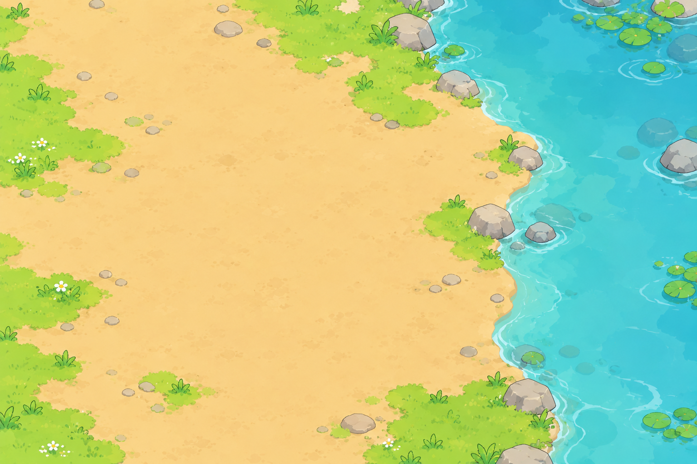
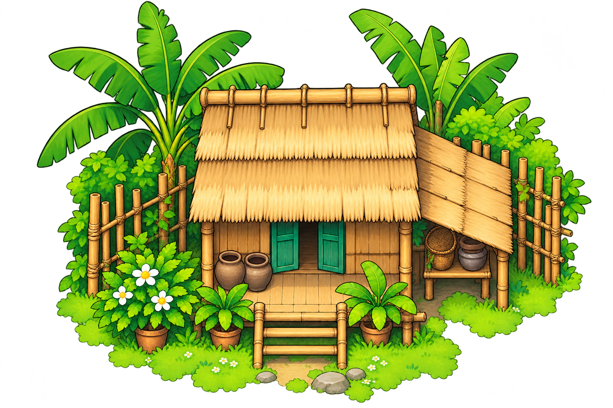

# Beast Link Battle — Hướng dẫn nền menu parallax và prompt tạo ảnh

Trạng thái: Bản hướng dẫn nháp; chưa tạo ảnh mới, chưa duyệt phong cách hoặc xác nhận sẵn sàng tích hợp. Phần hướng dẫn viết bằng tiếng Việt; các khối prompt giữ tiếng Anh để đưa trực tiếp vào công cụ tạo ảnh.

## 1. Định hướng hình ảnh

Giữ không khí ấm áp của menu hiện tại: nhà mái lá bên sông, kết cấu tre, cửa xanh, đất màu kem, cây xanh và nước xanh ngọc. Menu dẫn vào cả Làng và thám hiểm. Cảnh menu có bố cục riêng, khác chiến trường và bản đồ Làng nhìn từ trên xuống.

Nguồn định hướng: ART_AGENT_INSTRUCTIONS.md; art/style/STYLE_BIBLE.md; STYLE_LOCK_PROMPT.md; ASSET_QA_CHECKLIST.md; ASSET_MANIFEST.md; docs/BATTLE-ART-DIRECTION-V2.md. Tài liệu V2 hướng đến nhân vật đơn giản hơn; môi trường vẫn cần thống nhất với ảnh dự án. Các quy tắc tỷ lệ cơ thể và tư thế nhân vật trong khối khóa phong cách không áp dụng cho công trình. Phạm vi này chỉ tạo cảnh nền.

Menu hiện dùng complete.png làm nền CSS phủ kín khung và house.png làm lớp nhà riêng. complete.png chỉ chứa nền đất bên sông, chưa có nhà. Khi tạo lớp nền, tránh vẽ trùng đường bờ sông hoặc thêm nhà thứ hai.

## 2. Ảnh tham chiếu đầu vào

Đính kèm tệp ảnh thật trong mỗi lần tạo. Chỉ ghi tên tệp trong prompt không giúp công cụ nhìn thấy ảnh.

| Đầu vào | Tệp | Vai trò |
| --- | --- | --- |
| Ảnh 1 | public/assets/ui/camp/river-owner-v1/complete.png | Tham chiếu đất, sông, cây, bảng màu và đường viền do chủ dự án cung cấp |
| Ảnh 2 | public/assets/ui/camp/river-owner-v1/house.png | Khóa nhận diện nhà: mái lá, kết cấu tre, cửa xanh và cây nhiệt đới |
| Ảnh 3, tùy chọn | Ảnh chụp menu hiện tại | Tham chiếu vị trí và thứ bậc giao diện; không vẽ giao diện vào ảnh nền |
| Cảnh tổng thể đã duyệt, bổ sung sau | menu_master_landscape_approved_v01.png hoặc bản chiều dọc tương ứng | Chuẩn bố cục, kích thước và vị trí để tách mọi lớp |




Hai ảnh nhà và sông có độ cao góc nhìn khác nhau. Cần chốt một góc nhìn thống nhất cho cảnh menu trước. Ưu tiên nhìn mặt trước nhà từ hơi cao, mặt đất lùi nhẹ về phía sau; tránh ghép sông nhìn thẳng từ trên xuống với nhà nhìn ngang. Khi tạo cảnh mới, giữ nhận diện của ảnh gốc và điều chỉnh phối cảnh cho thống nhất.

## 3. Quy định bố cục

- Cảnh chiều ngang: yêu cầu tỷ lệ 16:9, kích thước đích 1920×1080.
- Cảnh chiều dọc: yêu cầu tỷ lệ 9:16, kích thước đích 1080×1920; bố trí lại từ cảnh ngang đã duyệt, không chỉ cắt hẹp ảnh.
- Đây là kích thước đích. Kiểm tra ảnh thực tế trước khi chuẩn hóa; không kéo giãn để ép tỷ lệ.
- Nhà ở giữa; cửa và bậc thềm là điểm nhìn chính. Nhà nằm khoảng vùng 35–70% chiều cao ảnh, điều chỉnh theo hướng màn hình.
- Vùng tiêu đề phía trên: x 25–75%, y 4–20%; màu dịu, ít chi tiết.
- Vùng nút phía dưới: x 20–80%, y 78–96%; nền đất yên, không có đạo cụ, gợn nước hoặc vùng sáng mạnh chạy qua nút.
- Nhân vật là ảnh riêng được đặt trước nhà trong game; không vẽ cư dân vào nền.
- Ảnh nền không chứa tiêu đề, chữ, biển hiệu, nút, biểu tượng, khung giao diện, dấu bản quyền hoặc bóng nhân vật.
- Ánh sáng ban ngày mềm từ trên trái; bóng mặt đất nhẹ. Tránh màu neon, phát sáng quá mức và phản chiếu nước tả thực.

## 4. Prompt tạo cảnh tổng thể chiều ngang — sẵn để sao chép

Đính kèm ảnh 1 và ảnh 2 theo đúng thứ tự. Đặt transparent_background=false để tạo nền không trong suốt.

```text
BEAST LINK BATTLE — CUTE TACTICAL CHIBI STYLE LOCK:

2D semi-chibi tactical creature game asset, Gen Z-friendly but not childish, clean readable silhouette, head approximately 35–40% of total character height, compact full body, soft colored medium-weight outlines with a slightly stronger outer contour, simple flat base colors, one to two steps of cel shading, minimal controlled highlights, low-to-medium intentional detail density, pastel fantasy palette with one strong controlled accent, clear role-driven shape language, only two to three primary character motifs, mobile/gameplay readability at small scale, expressive face with simple eyes, handcrafted designed feeling, consistent stylized materials, full-body 3/4 front presentation, no extreme perspective.

AVOID:

3D render, photorealism, painterly splash art, hyper-detailed fur, realistic material rendering, plastic glossy surfaces, complex fantasy armor filigree, random gold ornaments, random jewelry, excessive crystals, excessive bloom, rainbow lighting, multiple unrelated glow colors, giant baby eyes, oversized baby head proportions, generic anime human face, overcomplicated costume layers, unnecessary symbols, highly cinematic perspective, dramatic low-angle camera, busy background, decorative particles that reduce silhouette readability, random asymmetry with no design purpose, excessive symmetry decoration, AI detail spam.

ASSET TYPE:
One complete composition candidate for a mobile-first game main-menu environment, landscape 16:9. Requested final production canvas 1920 by 1080 pixels. This is an environment only; the character anatomy, head ratio and character pose clauses in the style lock do not apply to architecture. Do not create characters.

REFERENCE ROLES:
Image 1 is the owner-supplied riverside palette, earth, water and vegetation reference. Image 2 is the strict house identity reference. Preserve the house's straw roof silhouette, bamboo structural language, green shutters, front steps and tropical garden motifs. Neither image is a ready-made combined scene. Resolve their different camera elevations into a single coherent composition. Do not introduce a different building style.

SCENE AND CAMERA:
A welcoming small riverside home in a quiet tropical village. Center the house as the focal subject. Show its front facade from a slightly elevated front view, with gently receding ground; match the house reference without exaggerated lens perspective. A calm cyan river remains to the right, warm pale-ochre earth leads toward the entrance, and broad soft-green plants frame the outer edges. No sky/horizon band, mountains, extra buildings, new bridges or invented gameplay stations.

COMPOSITION:
Keep the central upper area, x 25–75 percent and y 4–20 percent, quiet for a separately rendered title. Keep the lower center, x 20–80 percent and y 78–96 percent, clear for two separately rendered menu buttons. House entrance/front steps sit around the central middle of the frame. Leave standing space in front of the house for existing character sprites, but do not paint those characters or their shadows. Use broad readable forms with reduced tiny texture. Keep focal objects safely away from canvas edges. The scene should remain readable on a small mobile display.

LIGHT AND MATERIALS:
Warm diffuse daylight from the upper left. Simplified straw, bamboo, earth and foliage. One or two restrained shading steps, gentle colored contours, minimal water highlights. Match the attached owner assets more strongly than generic fantasy illustration.

LAYER-AWARE DESIGN:
Compose clearly separable river water, terrain/shore, house group and sparse edge foreground vegetation. No foreground overlap through the title/button zones. Do not include detached shadows that belong to moving characters. This output is a composition proof, not a packed sprite sheet or layered file.

OUTPUT:
One clean full-scene image. Opaque background. No text, logo, labels, numbers, UI, button shapes, watermark, frame or characters.
```

### Prompt bố trí lại cảnh cho chiều dọc

Đính kèm cảnh ngang đã duyệt làm ảnh 1 và nhà gốc làm ảnh 2. Sao chép nguyên hai khối khóa phong cách và điều cần tránh ở trên, sau đó thêm khối prompt dưới đây. Đặt transparent_background=false.

```text
ASSET:
Portrait 9:16 main-menu composition for the same Beast Link Battle scene, requested final canvas 1080 by 1920. Image 1 is the approved landscape master, Image 2 is the original house identity. Recompose for portrait; do not stretch or take a narrow crop. Preserve house identity, palette, outline, material simplification, camera elevation and light direction. The house remains central, the river stays right, edge vegetation frames the scene. Preserve a quiet top title zone at y 4–20 percent and a quiet bottom action zone at y 78–96 percent. Keep the complete entrance, roof and front standing area visible. Do not shrink the house into an unreadable distant object. No new buildings, characters, UI or lettering. Produce one complete opaque portrait composition candidate.
```

Duyệt riêng từng bố cục trước khi tách lớp. Việc duyệt cảnh menu không đồng nghĩa duyệt tạo thêm cả đội hình nhân vật.

## 5. Tạo các lớp — dùng chung cảnh chuẩn và vị trí gốc

Mỗi lần tạo chỉ xuất một lớp, không ghép nhiều ảnh lớp thu nhỏ vào một tấm. Đính kèm cảnh đã duyệt đúng hướng màn hình. Mỗi yêu cầu gồm: hai khối khóa phong cách/điều cần tránh ở mục 4 → khối quy định chung dưới đây → đúng một khối prompt của lớp cần tạo.

```text
LAYER EXTRACTION CONTRACT:
The attached image is the approved master scene and the edit target. Produce only the requested layer from that exact scene. Preserve the entire master canvas, aspect ratio, camera, object size, pixel placement, colors, contour thickness and lighting. Do not crop to visible content, recenter, enlarge, rotate or independently redesign any object. The layer must overlay the master at identity transform. Preserve empty canvas space. Where a specified object has hidden surfaces, complete only those surfaces in the same style to support the small intended motion; do not change its visible silhouette. Do not add UI, labels, characters or unrelated objects. Return one image, not a contact sheet. Follow the alpha requirement for this layer exactly.
```

| Tệp | Nội dung | Độ trong suốt | Chuyển động đề xuất |
| --- | --- | --- | --- |
| menu_00_base_v01.png | Lớp màu đất/nước phủ toàn bộ khung ảnh | Không trong suốt | Cố định; phủ phần hở bên dưới |
| menu_01_water_v01.png | Mặt nước kéo dài xuống dưới đường bờ | Trong suốt ngoài vùng sông | Trượt nhẹ trong vùng che giới hạn; không dịch chuyển cả bờ |
| menu_02_shore_v01.png | Đất, bờ sông, bọt ven bờ và đá cố định | RGBA có vùng trong suốt | Cố định cùng đất |
| menu_03_house_v01.png | Nhà, tre/cây gắn với nhà và bóng tiếp đất | RGBA có vùng trong suốt | Cùng phép biến đổi với đất; không nổi độc lập |
| menu_04_foreground_v01.png | Lá thưa ở rìa ảnh, tách khỏi nhà | RGBA có vùng trong suốt | Dịch ngang nhẹ, nhanh hơn lớp xa |

### Lớp 00: nền phủ kín

```text
REQUESTED LAYER: 00 BASE UNDERPAINT.
Remove the house, foreground vegetation and all movable elements. Reconstruct the ground behind them and keep a continuous opaque pale earth/cyan river underpaint throughout the original canvas. Preserve the master shore geometry and camera. Broad simple colors, no new objects. This base must cover small gaps beneath overlays, not duplicate the house or detailed foreground. Opaque output, not transparent.
```

### Lớp 01: mặt nước

```text
REQUESTED LAYER: 01 WATER SURFACE.
Render only the calm cyan river surface, sparse simplified ripples and underwater color variation from the master. Continue water underneath shoreline/rocks by at least the planned small motion margin, but keep it out of the visible land. Exclude banks, shore foam, stones, plants and house. Keep the original river location. Genuine transparent alpha outside the extended river area, not a black, white or checkerboard background. Small drifting texture will be clipped beneath the fixed shore layer at runtime.
```

### Lớp 02: bờ sông và đất

```text
REQUESTED LAYER: 02 TERRAIN AND SHORE.
Render only the full connected land, bank vegetation anchored to the land, shore rocks and shoreline foam from the approved master. Remove house/its contact shadow and foreground edge leaves. Reconstruct the ground hidden by the house, preserving perspective and existing paths. Leave the open river surface truly transparent so layer 01 shows through; keep shoreline foam and rocks fixed on this layer. Preserve exact bank edge coordinates. Keep entire canvas and original registration. Genuine transparent alpha outside this terrain group.
```

### Lớp 03: nhóm ngôi nhà

```text
REQUESTED LAYER: 03 HOUSE GROUP.
Extract only the existing approved house with its bamboo fence, immediately attached shrubs/banana plants, front steps, pots and its contact shadow. Keep every visible object at the approved master position and scale; no separate centered house redesign. Transparent everywhere else. Do not include river, broad ground, characters or foreground plants belonging to other layers. Keep original canvas padding. Contact shadow stays with this anchored group, never independently parallaxed.
```

### Lớp 04: cây lá tiền cảnh

```text
REQUESTED LAYER: 04 EDGE FOREGROUND.
Extract only the sparse nearest edge leaves or shrubs explicitly visible as foreground in the approved master. Keep original size, location and canvas registration. Do not include plants attached to the house, shore rocks, ground, river or house. Do not fill the center, top title area or bottom button area. Genuine transparent alpha elsewhere. If the master contains no separable foreground, request a small in-context edge-only edit of the master first; do not invent a new foreground during extraction.
```

## 6. Quy tắc tích hợp vào game

- Prompt yêu cầu các lớp khớp nhau, nhưng AI không bảo đảm vị trí chính xác hoặc độ trong suốt thật. Kiểm tra đầu ra trước khi dùng; prompt không tự biến ảnh thành tài sản sẵn sàng tích hợp.
- Ghép từng bộ chiều ngang/dọc ở vị trí gốc, chưa thêm dịch chuyển, xoay hoặc đổi tỷ lệ; so sánh với cảnh đã duyệt. Loại ảnh có bờ sông trùng, viền sáng, nhà lệch tâm, bóng lặp hoặc phần nền bị thiếu.
- Nhà và đất dùng chung điểm neo và phép biến đổi. Bước đầu giữ nền, bờ và nhà cố định. Nước trượt dưới vùng che giới hạn của sông; cây lá tiền cảnh có thể dịch độc lập vì không quyết định vị trí tiếp đất của nhà.
- Chỉ thêm lớp bờ xa khi cảnh chuẩn đã có mặt phẳng chiều sâu tách được. Không tự thêm trời hoặc mây cho bố cục không có đường chân trời này.
- Nếu chuyển động làm hở mép, yêu cầu vẽ mở rộng thêm 5% ở rìa. Mọi lớp phải dùng chung khung ảnh và vị trí, không cắt khác nhau tùy lớp.
- Biên độ thử ban đầu trên màn hình: lá rìa ±4–8 pixel CSS; nước ±2–4 pixel trong vùng che. Đây là thông số thử khi tích hợp, chưa phải tiêu chí duyệt hình ảnh.
- Chữ, nút và nhân vật tách khỏi nền. Giao diện không dịch theo con trỏ hoặc độ nghiêng máy. Bước đầu dùng chuyển động chậm tự chạy; phản hồi con trỏ là tùy chọn cho web, chưa cần quyền cảm biến nghiêng.
- Dừng chuyển động khi tab ẩn; chế độ giảm chuyển động hiển thị cảnh tĩnh đã duyệt. Chừa vùng an toàn cho giao diện quanh tai thỏ/cạnh màn hình, không kéo giãn ảnh để bù.
- Menu và bản đồ Làng có quy định camera riêng; không lấy các lớp bản đồ nhìn từ trên xuống để giả lập chiều sâu menu.

## 7. Kiểm tra chất lượng và bàn giao

1. Duyệt cảnh tổng thể chiều ngang rồi chiều dọc: thống nhất nhà, góc nhìn và ánh sáng; vùng tiêu đề/nút ít chi tiết; hình khối đọc được trên điện thoại.
2. Tạo từng lớp với ảnh chuẩn đã duyệt đính kèm. Kiểm tra kích thước thực và kênh trong suốt RGBA; ảnh vẽ nền ô bàn cờ không phải ảnh trong suốt thật.
3. Ghép lớp 00–04, kiểm tra chồng lấn, đường bờ, bóng và phần nền khuất được vẽ bù.
4. Xem thử ở biên độ chuyển động lớn nhất; kiểm tra chiều dọc, 16:9 và điện thoại ngang màn hình rộng. Không hở vùng trong suốt hoặc để cây trượt qua nút.
5. Kiểm tra giới hạn ảnh và bộ nhớ trên điện thoại thật. Năm lớp RGBA toàn khung có thể tốn nhiều bộ nhớ sau giải mã; chỉ cắt ảnh dùng trong game khi đã ghi lại vị trí gốc, giảm kích thước có chủ đích và giữ ảnh nguồn.
6. Ghi khung ảnh, vùng cắt, điểm neo chuẩn hóa, hướng màn hình và nhóm biến đổi của mỗi lớp. Lưu ảnh tham chiếu, prompt và trạng thái duyệt.

Thư mục ảnh nháp: art/menu/parallax/v01/. Ảnh ứng viên tích hợp sau khi xem xét: public/assets/ui/menu/parallax/v01/. Đánh phiên bản tệp và giữ nguyên ảnh gốc của chủ dự án.

Mẫu yêu cầu dành cho Codex: “Dùng tài liệu này và hai ảnh tham chiếu của chủ dự án, chỉ tạo cảnh tổng thể chiều ngang trước. Hiển thị kết quả và prompt đã dùng. Sau khi tôi duyệt cảnh, tạo bản chiều dọc và các lớp khớp vị trí; giữ nguyên tệp ảnh nguồn.”
