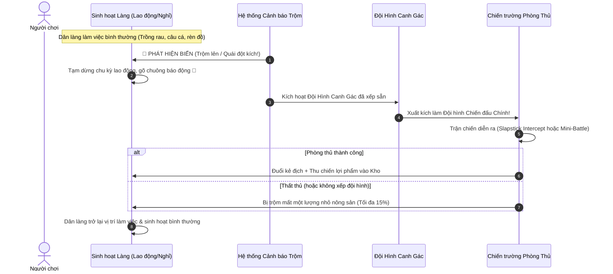

# Thiết kế Cơ chế Làng: Đội Hình Canh Gác, Đạo Tặc & Phòng Thủ (Village Guard Formation & Defense System)

Ngày: 2026-10-14.  
Trạng thái: **ĐỀ XUẤT THIẾT KẾ ĐÃ CẬP NHẬT THEO YÊU CẦU CHỦ DỰ ÁN (Pending Owner Review)**.  
Tài liệu liên quan:
- [BEAST-VILLAGE-DESIGN-2026-10-09.md](BEAST-VILLAGE-DESIGN-2026-10-09.md) — Thiết kế tổng quan Làng Thú.
- [VILLAGE-LIFE-ECONOMY-DESIGN-2026-10-09.md](VILLAGE-LIFE-ECONOMY-DESIGN-2026-10-09.md) — Kinh tế sinh hoạt, kho và sổ thu chi.
- [VILLAGE-SYSTEM-ALIGNMENT-2026-10-09.md](VILLAGE-SYSTEM-ALIGNMENT-2026-10-09.md) — Đồng bộ tọa độ thế giới và trạm.

---

## 1. Triết lý Thiết kế: "Toàn Dân Là Vệ Binh"

Theo chỉ đạo mới nhất từ chủ dự án:
> *"Mỗi dân làng đều là người bảo vệ đồng thời cũng có công việc riêng, khi trộm đến, địch tấn công đều có thể chiến đấu. Cần 1 giao diện để xếp đội hình canh gác. Khi có biến xảy ra thì đội hình đó là đội hình chính để chiến đấu."*

1. **Không phân biệt giai cấp lính - thợ:**
   - Cư dân hàng ngày vẫn hăng say làm việc chuyên môn để nuôi sống làng (Windstrider trồng cà rốt, Shadowclaw câu cá, Ironclad gia công xưởng mộc, Snowguard tuần tra giao nhận).
   - Họ không bị tước bỏ nghề nghiệp để trở thành lính canh gác tĩnh vô công rồi nghề.
2. **Sẵn sàng chiến đấu (Always Battle-Ready):**
   - Mọi Beast đều giữ nguyên các chỉ số sức mạnh đã có (STAR, Base HP, Damage, Signature Skill).
   - Người chơi thiết lập trước một **Đội Hình Canh Gác (Guard Formation)**.
3. **Triệu tập tức thì khi có biến (Rallying on Alarm):**
   - Khi kẻ trộm lẻn vào hoặc bầy quái rừng đột kích, chuông báo động reo lên. Đội hình canh gác được lập trình sẵn sẽ **tự động xuất kích làm đội hình chính**, trực tiếp nghênh chiến bảo vệ kho tàng và sự bình yên của làng.

---

## 2. Giao diện Xếp Đội Hình Canh Gác (Village Guard Formation UI)

### 2.1. Điểm truy cập giao diện
- **Nút "Đội Canh Gác" (🛡️ Đội Phòng Thủ)** xuất hiện nổi bật trên thanh Navigation / HUD của Làng (cạnh nút *Kho*, *Cư dân*, *Xây dựng*), hoặc nhấp trực tiếp vào **Trạm gác Cổng làng**.

### 2.2. Bố cục Giao diện Xếp Đội Hình
Giao diện tận dụng cơ chế quen thuộc của hệ thống `BattleFormation` để tạo tính liền mạch:

```
+--------------------------------------------------------------------------------+
|  [← Quay lại Làng]      ĐỘI HÌNH CANH GÁC LÀNG (4/4 Cư dân)      [Lưu đội hình] |
+--------------------------------------------------------------------------------+
|  CHIẾN ĐỊA PHÒNG THỦ LÀNG (Lưới 6 Cột x 3 Hàng)                                |
|                                                                                |
|  [HÀNG ĐẦU - Frontline]  [ Slot F-1 ] [ Slot F-2 ] [ Slot F-3 ] ...            |
|                          (Ưu tiên Tanker: Snowguard, Ironclad che chắn)        |
|                                                                                |
|  [HÀNG GIỮA - Midline]   [ Slot M-1 ] [ Slot M-2 ] [ Slot M-3 ] ...            |
|                          (Đấu sĩ / Sát thủ / Hỗ trợ)                           |
|                                                                                |
|  [HÀNG SAU - Backline]   [ Slot B-1 ] [ Slot B-2 ] [ Slot B-3 ] ...            |
|                          (Xạ thủ / Pháp sư: Starcaller, Swiftwing)             |
+--------------------------------------------------------------------------------+
|  DANH SÁCH DÂN LÀNG HIỆN CÓ (Kéo thả hoặc chạm để đưa vào đội hình):           |
|  [ 🦆 Snowguard ★1 ] [ 🐰 Windstrider ★2 ] [ 🐻 Ironclad ★1 ] [ 🐱 Shadowclaw ★1 ] ...|
|  (Hiển thị: Icon nghề hiện tại + Role chiến đấu + Trạng thái no/đói)            |
+--------------------------------------------------------------------------------+
```

### 2.3. Quy tắc Đội hình
- **Số lượng triển khai:** Mặc định **4 cư dân** (hoặc mở rộng lên 5 nếu đã nâng cấp sức chứa làng).
- **Phân công chiến thuật:**
  - Cư dân đặt ở hàng nào sẽ nhận đúng đặc tính chiến đấu của hàng đó (Frontline hút đòn và kích hoạt liên kết che chở *Frontline cover tethers*, Backline được bảo vệ an toàn để xả sát thương).
- **Lưu trữ trạng thái:** Đội hình được serialize vào `CampState.defenseFormation` dưới dạng:
  ```typescript
  interface VillageDefenseFormation {
    slots: Array<{ slotId: string; beastId: string }>;
  }
  ```
  Lưu trữ an toàn, tự động kiểm tra tính hợp lệ (cư dân phải thực sự đang sống tại làng).

---

## 3. Mạng Lưới Đường Đi (Path & Waypoints) & Ma Trận Hoạt Ảnh Dân Làng

### 3.1. Sơ đồ Đường Đi Tránh Vật Cản (Village Navigation Graph)
Để khắc phục hiện tượng dân làng đi cắt chéo đâm xuyên Nhà chung hoặc rơi xuống nước, bản đồ thế giới ($1536 \times 1024\,\text{px}$) được thiết lập hệ thống **Waypoints (Nút giao thông trên đường mòn cát)**:

```
[Nhà chung: (210,8)-(630,338)]                      [Mép sông nước]
               │                                            │
               ▼                                            ▼
       (WP_NORTH_ROAD: 420, 380)                    (WP_PIER_ROAD: 1020, 680) ──> [Bến cá: 1095, 650]
               │                                            │
               ├───────────────────┬────────────────────────┤
               ▼                   ▼                        │
[Vườn: 440, 510] <── (WP_GARDEN: 460, 580)   (WP_CENTRAL: 680, 680) [Sân chung / Bãi cỏ]
                                   │                        │
                                   │            (WP_FORGE_ROAD: 650, 480) ──> [Xưởng: 648, 460]
                                   ▼                        │
[Cổng làng: 180, 880] <── (WP_GATE: 240, 850) ──────────────┴─────── (WP_SOUTH_FENCE: 750, 880)
   (Trạm gác)                  ▲                                        ▲
                               └────────── [ LỘ TRÌNH TUẦN TRA ] ───────┘
```

- **Nguyên tắc di chuyển:**
  - Cư dân không bao giờ đi thẳng theo đường chim bay nếu đường đi cắt qua vùng chướng ngại vật (Nhà chung, Thửa ruộng, Hồ nước).
  - Thuật toán tìm đường sẽ nối: $\text{Vị trí hiện tại} \rightarrow \text{Waypoint gần nhất} \rightarrow \text{Waypoint đích} \rightarrow \text{Điểm làm việc/nghỉ}$.
  - Vận tốc di chuyển chuẩn: $85\,\text{px/giây}$ (Lao động), $70\,\text{px/giây}$ (Lính gác đi tuần).
- **Lộ trình Tuần tra của Đội hình Canh gác (Guard Patrol Route):**
  - Vòng tuần tra khép kín men theo bờ rào phía Nam và cổng vào:
    $$\text{Trạm gác Cổng } (180, 880) \longleftrightarrow \text{WP\_GATE } (240, 850) \longleftrightarrow \text{WP\_SOUTH\_FENCE } (750, 880) \longleftrightarrow \text{WP\_CENTRAL } (680, 680)$$
  - Lính gác dừng lại quan sát $3\,\text{s} - 5\,\text{s}$ tại mỗi nút trước khi bước tiếp.

---

### 3.2. Ma Trận Hoạt Động & Hoạt Ảnh Dân Làng (Animation Matrix)

| Trạng thái | Hoạt ảnh trực quan (Visual Animation) | Âm thanh / Hiệu ứng truyện tranh | Diễn giải |
|---|---|---|---|
| **`IDLE / REST`** | - Nhún nhảy nhịp nhàng (bobbing $1.2\,\text{s}$)<br>- Mắt chớp, biểu cảm thư thái<br>- Ở bồn tắm: Sủi bọt nước bong bóng | Tiếng chim hót / Gió thổi | Đang trong giờ nghỉ ngơi giữa các ca làm |
| **`WALKING`** | - Dáng đi nảy bước nhịp nhàng (chibi hop)<br>- **Facing:** Lật gương theo trục X (`scaleX: 1` sang phải, `scaleX: -1` sang trái) | Tiếng bước chân nhẹ trên cát | Đang đi theo mạng lưới Waypoints tới nơi làm việc |
| **`WORKING (Vườn)`** | - Windstrider cầm bình tưới nghiêng 45°<br>- Hạt nước lấp lánh rơi xuống luống đất<br>- Đôi lúc cúi xuống cắn trộm 1 miếng cà rốt | Comic text: `CHOMP!`<br>Tia nước bắn tung tóe | Sản xuất Cà rốt; có sự cố củ cà rốt khổng lồ kéo ngược |
| **`WORKING (Bến cá)`**| - Shadowclaw vung cần câu uốn cong<br>- Phao câu nhấp nhô trên mặt nước<br>- Giật mạnh cần lên khi xong lượt | Comic text: `SPLASH!`<br>Gợn sóng lăn tăn | Sản xuất Cá; có sự cố kéo lên chiếc ủng rách |
| **`WORKING (Xưởng)`** | - Ironclad giơ búa lên cao rồi gõ xuống đe<br>- Khói nhẹ bốc lên từ ống khói lò rèn<br>- Dăm gỗ / tia lửa nhỏ nảy lên | Comic text: `CLANG! CLANG!`<br>Mẩu gỗ văng nhẹ | Sản xuất Đồ chơi; có sự cố đập trúng ngón chân nhảy lò cò |
| **`PATROL (Canh gác)`**| - Vác khiên paw-shield / búa đi tuần quanh bờ rào<br>- Dừng lại quay mặt trái/phải quan sát | Nhạc nền căng thẳng nhẹ khi đêm xuống | Dân làng trong đội hình canh gác đi tuần tra bảo vệ |
| **`ALERT (Báo động)`**| - Nhảy bật cẫng lên ($15\,\text{px}$), mắt mở to<br>- Trên đầu hiện dấu chấm than đỏ `!` hoặc icon 🔔 | Tiếng chuông làng gióng dồn dập | Phát hiện bóng dáng kẻ trộm bò qua hàng rào |
| **`ENGAGE (Xuất kích)`**| - Đội hình canh gác ùa tới với vệt khói bụi dưới chân (dust puff)<br>- Vung khiên/búa chặn đầu | Comic badge: `BONK!`, `POOF!`, `OUCH!` | Bắt quả tang kẻ trộm hoặc chuyển cảnh sang Mini-Battle |

---

## 4. Nhà Riêng Cho Từng Thú (Beast Cottages & Private Housing)

### 4.1. Điều kiện Xây Nhà Riêng
Nhà riêng là dấu mốc "an cư lạc nghiệp" của từng Beast sau hành trình thám hiểm và cống hiến cho làng:
1. **Cột mốc Sao & Trưởng thành (STAR Level):** Beast đạt **2★** hoặc **3★** (sử dụng hệ thống sao tiến hóa sẵn có).
2. **Tài nguyên kết hợp (Vật liệu thám hiểm + Sản vật chuyên môn):**
   - **Gỗ Rừng (từ Run):** 30 Gỗ dựng khung nhà.
   - **Đồng Làng (từ quỹ làng):** 15 Đồng công thợ.
   - **Sản vật đặc trưng do chính nghề của Beast đó làm ra:**
     - *Nhà Thỏ Windstrider:* Cần thêm 10 Cà rốt tự trồng.
     - *Nhà Gấu Ironclad:* Cần thêm 2 Đồ chơi gỗ tự gọt.
     - *Nhà Mèo Shadowclaw:* Cần thêm 5 Con cá tự câu.
3. **Mặt bằng Làng (Village Plots):** Đặt tại các khoảnh đất bìa rừng hoặc triền dốc bao quanh làng.

### 4.2. Mục đích & Giá trị Gameplay
- **Cảm xúc & Cá tính kiến trúc:** Mỗi Beast có một kiểu nhà riêng mang đậm hình thái loài (Nhà vòm cà rốt, Cabin lò rèn, Hải đăng phao bơi, Chòi câu ven sông). Đêm xuống Thú về nhà ngủ ấm cúng thay vì đứng ngoài trời.
- **Tiện nghi & Chống đói:** Thú có nhà riêng được ngủ đệm ấm, khi làng lỡ thiếu ăn trong 1 ngày vẫn giữ tinh thần thoải mái, **không bị phạt giảm 25% tốc độ làm việc**.
- **Chòi canh vệ tinh chống trộm (Outpost Alert):** Khi kẻ trộm lẻn qua phạm vi gần nhà riêng của Beast nào, Beast đó sẽ **lập tức bật đèn lao ra khỏi cửa nhà bắt quả tang**, không cần đợi lính gác cổng chạy tới.
- **Sĩ khí bảo vệ mái ấm (Home Defense Shield):** Khi tham gia Đội hình phòng thủ làng, Beast có nhà riêng được nhận thêm **lớp khiên 10% HP tối đa** khi vào trận vì mang tâm lý quyết tử bảo vệ tổ ấm.

---

## 5. Bảng Hồ Sơ & Thuộc Tính Đầy Đủ Của 10 Thú (Beast Village Profiles)

### 5.1. Cấu trúc Thuộc tính Mở rộng (Extended Schema)
```typescript
export interface BeastVillageProfile {
  beastId: string;
  displayName: string;
  role: 'Tanker' | 'Assassin' | 'Ranger' | 'Mage';
  profession: string;
  workStationId: 'garden' | 'fishing' | 'forge' | null;
  favoriteFood: 'carrot' | 'fish';
  housing: {
    cottageType: string;
    decorTheme: string;
    unlockReq: { star: 2; wood: number; coins: number; specialItem: string };
  };
  defense: {
    recommendedRow: 'Front' | 'Mid' | 'Back';
    patrolStyle: string;
    alertRadius: number; // Tầm phát hiện trộm (world pixels)
    homeShieldBonus: number; // Lượng khiên khi đã có nhà
  };
}
```

### 5.2. Ma Trận Thuộc Tính 10 Cư Dân Làng Quê

| Beast ID | Tên Thú | Nghề nghiệp chính | Món ăn thích | Kiểu Nhà Riêng | Vị trí Đội Canh Gác | Đặc tính Canh Gác & Tuần Tra |
|---|---|---|:---:|---|:---:|---|
| `beast-a` | **Snowguard** (Vịt) | Bảo vệ kiêm giao hàng | Cà rốt & Cá | **Hải đăng vịt con** (có phao bơi và chậu hoa) | **Frontline** | Đi tuần nghiêm nghị, cầm paw-shield chặn đầu trộm cực nhanh. |
| `beast-b` | **Shadowclaw** (Mèo) | Cần thủ bến sông | Cá tươi 🐟 | **Chòi cọc ven sông** (có giàn phơi cá khô) | **Front / Mid** | Rình rập trong bóng râm, tầm phát hiện trộm đêm xa nhất ($250\,\text{px}$). |
| `beast-c` | **Windstrider** (Thỏ) | Nông dân trồng rau | Cà rốt 🥕 | **Nhà vòm củ cà rốt** (mái đất có hoa leo) | **Mid / Back** | Di chuyển nhanh nhẹn, tung cước FocusShot xua đuổi kẻ trộm vườn. |
| `beast-d` | **Starcaller** (Vịt pháp sư) | Nhà thiên văn & Trà quán | Cà rốt | **Tháp đài thiên văn** (mái vòm kính viễn vọng) | **Backline** | Phát hiện trộm bằng mắt thần ma pháp, khống chế diện rộng. |
| `beast-e` | **Ironclad** (Gấu) | Thợ rèn & Thợ mộc | Cà rốt & Cá | **Cabin gỗ ấm áp** (có lò rèn và ống khói) | **Frontline** | Sức răn đe lớn, gõ búa khiến trộm hoảng loạn làm rơi thêm tiền. |
| `beast-f` | **Swiftwing** (Chim) | Người đưa thư làng | Cá | **Tổ chim gác mái** (treo chuông gió trên cây) | **Backline** | Bay tuần tra nhanh, gõ chuông báo động làng sớm nhất. |
| `beast-g` | **Woolkeeper** (Cừu) | Thợ may & Trông trẻ | Cà rốt 🥕 | **Căn nhà đan len** (ấm cúng phủ rơm mềm) | **Backline** | Cứu thương và tạo giáp hỗ trợ cho các đồng đội tiền tuyến. |
| `beast-h` | **Hophex** (Thỏ bay) | Nghệ nhân hoa cỏ | Cà rốt | **Chòi hoa bóng nước** (mái kết bằng dây leo) | **Mid / Back** | Thả bẫy bóng nước giữ chân kẻ trộm ngay tại chỗ. |
| `beast-i` | **Gadgetduck** (Vịt thợ máy)| Sáng chế đồ chơi | Cá | **Xưởng máy tí hon** (chong chóng gió quay tít) | **Mid / Back** | Chế tạo còi báo động tự động dọc theo bờ rào. |
| `beast-j` | **Boomhog** (Heo) | Đầu bếp xóm làng | Cà rốt & Cá | **Bếp lò bánh phồng** (mái ngói bám bột mì) | **Mid / Back** | Bắn pháo hoa rền vang xua đuổi bầy quái rừng đột kích. |

---

## 6. Quy Trình Vận Hành: Từ Đời Thường đến Xuất Kích



---

## 7. Các Loại Biến Cố & Cách Thức Nghênh Chiến

### 7.1. Biến cố 1: Kẻ trộm ranh mãnh (Sneaky Thief - Chồn/Chuột lủi)
- **Hành vi:** Lén mò vào luống Cà rốt hoặc thùng Cá ở bến sông.
- **Phản ứng của Đội hình Canh gác:**
  - Đội hình canh gác được triệu tập tức thì bao vây tên trộm.
  - Vị trí hàng đầu (Frontline) sẽ lao ra chặn đầu (`BONK!`), các vị trí phía sau khóa đường lui.
  - Tên trộm hốt hoảng vứt lại bao tải và đồ rơi rớt (1-2 Đồng tiền làng, mẩu dăm gỗ) rồi chuồn mất.
  - **Kết quả:** Bảo vệ an toàn $100\%$ nông sản trong kho.

### 7.2. Biến cố 2: Đạo tặc Rừng Sâu đột kích (Bandit Raid - Bầy heo rừng/cướp)
- **Hành vi:** Nhóm bot quái rừng kéo đến cổng làng nhắm vào kho Gỗ và Tiền mặt.
- **Nghênh chiến trực diện:**
  - Chuông làng reo vang, màn hình hiện cảnh báo: **"Đạo tặc tấn công! Đội hình canh gác xuất kích!"**
  - Mở trực tiếp màn hình chiến đấu (sử dụng `AutonomousBattleModel` và sàn đấu của làng).
  - **Phe Làng (Player Team):** Chính là 4 Beast đã được xếp sẵn trong **Đội Hình Canh Gác** (đầy đủ chiêu thức Signature, năng lượng Tactical Energy).
  - **Phe Địch (Enemy Raid Team):** Đội hình quái rừng theo các archetype có sẵn (`frontline-pressure` hoặc `backline-dive`).
- **Kết quả trận chiến:**
  - **Chiến thắng:** Đánh tan bầy cướp, nhận xe Gỗ chiến lợi phẩm (+10 Gỗ, +5 Đồng) nạp thẳng vào ví/kho.
  - **Thất bại:** Kẻ cướp lấy đi tối đa $15\%$ số Gỗ hoặc Cà rốt dư thừa. Dân làng tham chiến bị choáng nhẹ trong 30s trước khi hồi phục lại công việc.

---

## 8. Nguyên tắc An toàn & Hạch toán Kinh tế (Safety & Accounting)

1. **Nguyên tắc Kho An toàn (Safety Cap):**
   - Tuyệt đối không cướp sạch kho tài nguyên. Mức hao hụt tối đa luôn được khống chế dưới $15\%$ phần dôi dư để không làm gãy đổ chuỗi sản xuất thức ăn của làng.
2. **Hạch toán Minh bạch vào Sổ Thu Chi (`VillageLedger`):**
   - Mất mát do trộm ghi nhận mục: `type: 'waste'`, lý do: `Bị trộm cướp đột nhập`.
   - Chiến lợi phẩm thu được sau trận thắng ghi nhận: `type: 'grant'`, lý do: `Thu giữ từ bầy đạo tặc`.
3. **Ghi lại Chiến tích Hài hước vào Nhật ký (`VillageDiary`):**
   - *"Đội hình canh gác hợp lực đẩy lùi bầy heo rừng. Bác gấu Ironclad vung búa làm bay cả mũ giáp của tướng cướp."*
   - *"Thỏ Windstrider vừa nhai cà rốt vừa tung cước đuổi trộm, bảo vệ thành công kho lương."*

---

## 9. Kế hoạch Triển khai (Implementation Slices)

- **Slice 1: Cấu trúc Dữ liệu & Giao diện Xếp Đội Hình (Formation UI)**
  - Mở rộng `CampState` lưu trữ `defenseFormation: Array<{ slotId: string; beastId: string }>`.
  - Xây dựng modal `VillageDefenseFormationDialog.ts` cho phép kéo thả/chọn vị trí Front/Mid/Back từ danh sách `state.residents`.
  - Kiểm thử lưu trữ idempotent và di chuyển đội hình an toàn.

- **Slice 2: Bộ kích hoạt Biến cố & Tự động Triệu tập (Event & Auto-Rally)**
  - Tích hợp bộ đếm giờ biến cố trộm/cướp ngẫu nhiên trong `VillageEconomy.ts` (theo chu kỳ ngày làng).
  - Hiển thị hiệu ứng chuông báo động làng 🔔 và huy động Đội hình Canh gác ra cổng nghênh chiến.
  - Xử lý bắt quả tang slapstick và cập nhật biến cố vào Nhật ký.

- **Slice 3: Tích hợp Trận chiến Bảo vệ Làng (Village Defense Battle Engine)**
  - Kết nối Đội hình Canh gác làng trực tiếp vào `AutonomousBattleModel` cho các đợt đột kích lớn.
  - Hiển thị màn hình tổng kết phòng thủ: Chiến lợi phẩm thu được hoặc tài nguyên hao hụt.
